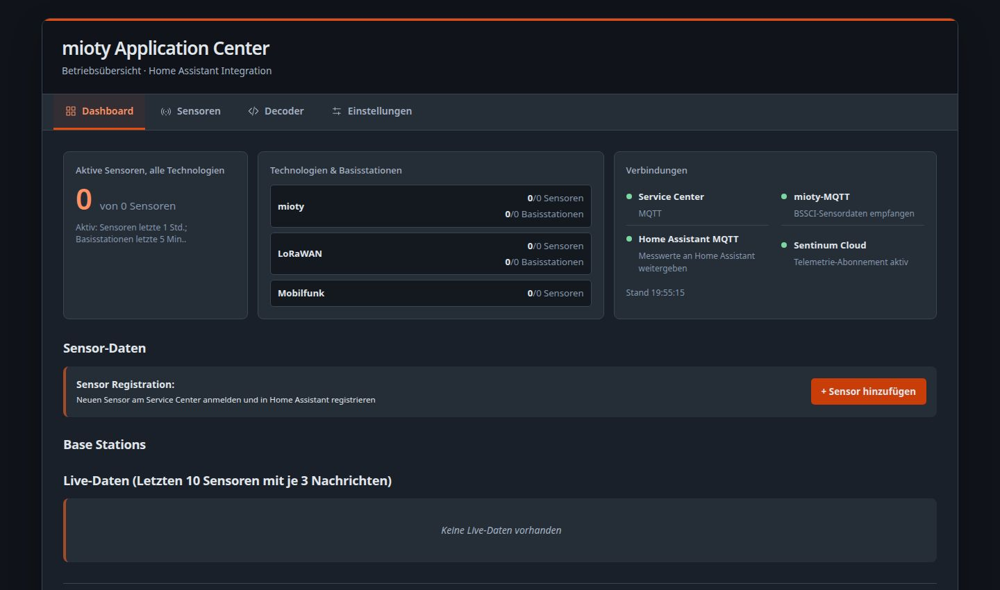
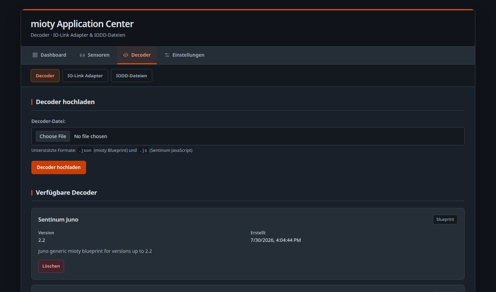
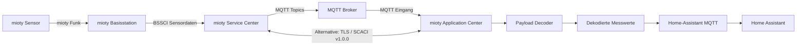

# 🚀 mioty Application Center für Home Assistant

**Deutsche Version einer umfassenden Home Assistant Add-on Lösung für mioty IoT Netzwerke**

Eine vollständige Home Assistant Add-on Lösung zur Verwaltung von mioty IoT Sensoren durch MQTT Integration mit automatisiertem Payload-Dekodierung System und Web-basierter Verwaltungsoberfläche.

## 📋 Inhaltsverzeichnis

- [Überblick](#-überblick)
- [Oberfläche](#-oberfläche)
- [MIOTY und SCACI](#-mioty-und-scaci)
- [Datenfluss-Architektur](#-datenfluss-architektur)
- [Installation](#-installation)
- [Konfiguration](#-konfiguration)
- [Web-Benutzeroberfläche](#-web-benutzeroberfläche)
- [Payload Decoder System](#-payload-decoder-system)
- [MQTT Integration](#-mqtt-integration)
- [Sensor-Management](#-sensor-management)
- [Technische Architektur](#-technische-architektur)
- [Fehlerbehebung](#-fehlerbehebung)
- [Support](#-support)

## 🌟 Überblick

Das **mioty Application Center für Home Assistant** ist eine umfassende Add-on Lösung, die mioty IoT Sensoren nahtlos in Home Assistant integriert. Es fungiert als Brücke zwischen dem BSSCI (Base Station Service Center Interface) und Home Assistant über MQTT-Kommunikation.

### Hauptfunktionen

- **Einheitliches Dashboard:** zuletzt aktive Sensoren über alle unterstützten Funktechnologien, aktive mioty-/LoRaWAN-Basisstationen und kompakte Verbindungsübersicht.
- **Verbindungen auf einen Blick:** Service Center, mioty-MQTT, Home Assistant MQTT und Sentinum Cloud; Status wird visuell angezeigt.
- **Sensormanagement nach Technologie:** Sensoren gruppiert nach mioty, LoRaWAN, OMS/Wireless M-Bus und Mobilfunk; Cloud-Sensoren werden als Quelle gekennzeichnet.
- **Sentinum Cloud:** optionale MQTT/TLS-Anbindung mit einstellbaren Zugangsdaten und Kunden-Topic; vorverarbeitete JSON-Messwerte werden ohne erneute Dekodierung übernommen.
- **Decoder:** mioty Blueprint (.json), Sentinum JavaScript (.js), IO-Link-Adapter und IODD-Dateien.
- **Home Assistant:** MQTT-Weitergabe von Messwerten und automatische Entity-Erstellung.
- **Hell- und Dunkelmodus:** Umschalter in den Einstellungen; die Auswahl wird lokal im Browser gespeichert.
- **Responsive Oberfläche:** deutsche Bedienoberfläche für Desktop und Mobilgeräte.

## 🖥️ Oberfläche



*Operative Übersicht mit Sensoraktivität, Basisstationen und den vier relevanten Verbindungen.*



*Decoder, IO-Link-Adapter und IODD-Dateien zentral verwalten.*

## 📡 MIOTY und SCACI

Die Verbindung zum mioty Service Center nutzt das **SC-AC Interface (SCACI) v1.0.0** über TLS. Implementiert sind unter anderem Sitzungsaufbau und -fortsetzung, Anfrage-/Antwort-/Abschlussabläufe, Sensorregistrierung, Statusmeldungen, Uplink sowie Downlink-Ergebnisse.

**Ziel der Implementierung ist eine 100 % MIOTY-konforme Kommunikation über SCACI v1.0.0.** Diese Aussage bezieht sich auf die Protokollanbindung des Add-ons. Sie stellt keine unabhängige oder formelle Produktzertifizierung dar.

Die Sensordaten durchlaufen weiterhin die vorhandenen Decoder und werden anschließend über MQTT an Home Assistant weitergegeben. Sentinum Cloud ist eine optionale, separate MQTT/TLS-Datenquelle.

## 🔄 Datenfluss-Architektur

*Der Datenzugang zum mioty Service Center kann wahlweise über MQTT oder direkt über SCACI erfolgen. Beide Wege führen in dieselbe Verarbeitung.*



## 📦 Installation

### Voraussetzungen

- Home Assistant 2023.1.0 oder höher
- MQTT Broker (z.B. Mosquitto Add-on)
- Aktives mioty Netzwerk mit BSSCI Service Center
- **Externe Abhängigkeit: [containerized mioty Service Center](https://github.com/plasmonized/containerized-mioty-Service-Center)** - erforderlich für vollständige Funktionalität
- GitHub Repository Zugang

### Add-on Installation

1. **Repository hinzufügen:**
   ```
   Supervisor → Add-on Store → ⋮ → Repositories → Repository hinzufügen
   https://github.com/plasmonized/mioty-homeassistant-addon
   ```

2. **Add-on installieren:**
   ```
   Add-on Store → mioty Application Center für Homeassistant → INSTALLIEREN
   ```

3. **Konfiguration:**
   ```yaml
   mqtt_broker: "core-mosquitto"
   mqtt_port: 1883
   mqtt_username: ""
   mqtt_password: ""
   base_topic: "bssci"
   auto_discovery: true
   log_level: "info"
   web_port: 5000
   ```

4. **Starten:**
   ```
   START → Web UI öffnen
   ```

## ⚙️ Konfiguration

### MQTT Broker Setup

```yaml
# Mosquitto Add-on Konfiguration
anonymous: false
logins:
  - username: mioty
    password: secure_password
customize:
  active: false
  folder: mosquitto
certfile: fullchain.pem
keyfile: privkey.pem
```

### Datenzugang über MQTT oder SCACI

Sensordaten können über den MQTT-Broker oder über die direkte TLS-Verbindung mit SCACI v1.0.0 empfangen werden. Der MQTT-Weg nutzt die mioty/BSSCI Topics:

```
Alle Daten fließen über den MQTT Broker
Base Topic: bssci/+
Erforderliche Endpunkte:
  - /api/sensors
  - /api/basestations
  - MQTT Bridge Funktionalität
```

## 🖥️ Web-Benutzeroberfläche

Die Web-GUI ist über die Home Assistant Ingress-Funktion erreichbar. Das dunkle Sentinum-Orange/Graphit-Design unterstützt jetzt einen Hellmodus. Die Auswahl wird lokal im verwendeten Browserprofil gespeichert und gilt für alle Seiten.

### Dashboard und Verbindungen

- Gesamtzahl und Aktivität der Sensoren über die erkannten Funktechnologien hinweg
- Aktivität von mioty- und LoRaWAN-Basisstationen
- Kompakte 2×2-Übersicht für Service Center, mioty-MQTT, Home Assistant MQTT und Sentinum Cloud; ein Statuspunkt kennzeichnet den Verbindungszustand

### Sensor-Management

- Sensorübersicht nach Technologie gruppiert: mioty, LoRaWAN, OMS/Wireless M-Bus und Mobilfunk
- Kennzeichnung der Datenquelle Sentinum Cloud und Anzeige der mobilfunkbasierten Geräte-ID
- Sensoren hinzufügen, bearbeiten, entfernen und – für mioty-Sensoren – beim Service Center erneut anlernen
- Live-Daten sowie Signal- und Statusinformationen

### Einstellungen und Datenquellen

- MQTT-Broker für mioty-/BSSCI-Daten und MQTT-Weitergabe an Home Assistant
- Optionale Sentinum-Cloud-Anbindung per MQTT/TLS mit eigenständigen Zugangsdaten, Kunden-Topic und vollständiger Deaktivierung
- Anzeige der Verbindungszustände der einzelnen Dienste
- Umschalter für Hell-/Dunkelmodus mit browserlokaler Speicherung

### Decoder- und IO-Link-Verwaltung

#### Unterstützte Decoder-Formate:

**1. mioty Blueprint Decoder (.json)**
```json
{
  "name": "Temperature Sensor",
  "version": "1.0",
  "description": "Standard temperature and humidity sensor",
  "decoder": {
    "fields": [
      {
        "name": "temperature",
        "type": "int16",
        "offset": 0,
        "scale": 0.1,
        "unit": "°C"
      },
      {
        "name": "humidity",
        "type": "uint8",
        "offset": 2,
        "scale": 1,
        "unit": "%"
      }
    ]
  }
}
```

**2. Sentinum JavaScript Decoder (.js)**
```javascript
function decode(bytes, port) {
    var decoded = {};
    
    if (bytes.length >= 3) {
        // Temperature (2 bytes, signed, 0.1°C resolution)
        var temp = (bytes[0] << 8) | bytes[1];
        if (temp > 32767) temp -= 65536;
        decoded.temperature = temp * 0.1;
        
        // Humidity (1 byte, unsigned, 1% resolution)
        decoded.humidity = bytes[2];
        
        // Battery voltage (2 bytes, unsigned, 0.01V resolution)
        if (bytes.length >= 5) {
            decoded.battery = ((bytes[3] << 8) | bytes[4]) * 0.01;
        }
    }
    
    return decoded;
}
```

#### Decoder-Funktionen:

- **Upload:** Drag & Drop oder Datei-Browser
- **Zuweisen:** Decoder zu spezifischen Sensor-EUIs zuordnen
- **Testen:** Live-Test mit Hex-Payloads
- **Verwalten:** Bearbeiten, löschen, neu zuweisen

## 🔧 Payload Decoder System

### Decoder Engine Architektur

```
Raw Payload (Hex) → Decoder Engine → Structured Data → Home Assistant Entities
```

**Beispiel Transformation:**
```
Input:  "01A2 03B4 05C6"
        ↓ Decoder Processing
Output: {
          "temperature": 24.5,
          "humidity": 68,
          "battery": 3.7
        }
```

### Decoder-Zuweisungen

Jeder Sensor kann einen individuellen Decoder haben:

```
Sensor EUI: fca84a030000127c → Temperature_Humidity_Decoder.js
Sensor EUI: 74731d0000000016 → Industrial_Sensor_Decoder.json
Sensor EUI: a1b2c3d400005678 → Custom_Blueprint_Decoder.json
```

### Fallback-Mechanismus

1. **Zugewiesener Decoder:** Verwende sensor-spezifischen Decoder
2. **Standard-Decoder:** Fallback auf Blueprint-Example
3. **Raw-Modus:** Zeige Hex-Payload unverändert an

## 📡 MQTT Integration

### Topic-Struktur

```
bssci/
├── ep/
│   ├── {sensor_eui}/
│   │   ├── ul          # Uplink sensor data
│   │   ├── dl          # Downlink commands
│   │   └── config      # Sensor configuration
├── bs/
│   └── {station_id}    # Base station status
└── system/
    └── status          # System-wide status
```

### Message-Formate

**Uplink Sensor Data:**
```json
{
  "eui": "fca84a030000127c",
  "timestamp": "2025-08-30T10:15:30Z",
  "payload": "01A203B4",
  "rssi": -89,
  "snr": 12,
  "basestation": "70b3d59cd00009f6"
}
```

**Base Station Status:**
```json
{
  "station_id": "70b3d59cd00009f6",
  "status": "online",
  "cpu_usage": 15.2,
  "memory_usage": 45.7,
  "uptime": 86400,
  "duty_cycle": 2.3
}
```

## 🏠 Home Assistant Integration

### Automatische Entity-Erstellung

Für jeden erkannten Sensor werden automatisch Entities erstellt:

```yaml
# Beispiel Sensor: fca84a030000127c
sensor.mioty_fca84a030000127c_temperature:
  friendly_name: "mioty Sensor Temperature"
  unit_of_measurement: "°C"
  device_class: "temperature"

sensor.mioty_fca84a030000127c_humidity:
  friendly_name: "mioty Sensor Humidity"
  unit_of_measurement: "%"
  device_class: "humidity"

sensor.mioty_fca84a030000127c_rssi:
  friendly_name: "mioty Sensor Signal Strength"
  unit_of_measurement: "dBm"
  device_class: "signal_strength"
```

### Device Registry Integration

```yaml
Device:
  name: "mioty Sensor (fca84a030000127c)"
  manufacturer: "mioty"
  model: "IoT Sensor"
  identifiers: ["mioty_fca84a030000127c"]
  via_device: "mioty_application_center"
```

## 🏗️ Technische Architektur

### Komponenten-Übersicht

```
mioty-application-center/
├── Dockerfile              # Container-Definition
├── config.yaml            # Add-on Konfiguration
├── run.sh                  # Startup-Script
├── requirements.txt        # Python Dependencies
└── app/
    ├── main.py            # Haupt-Anwendung
    ├── mqtt_manager.py    # MQTT Kommunikation
    ├── payload_decoder.py # Decoder Engine
    ├── decoder_manager.py # Decoder-Verwaltung
    ├── web_gui.py         # Flask Web-Interface
    ├── settings_manager.py # Konfiguration
    └── bssci_client.py    # BSSCI API Client
```

### Systemanforderungen

- **RAM:** 512 MB minimum, 1 GB empfohlen
- **CPU:** ARM/x86/x64 kompatibel
- **Storage:** 100 MB für Add-on + Decoder-Dateien
- **Netzwerk:** MQTT Broker Zugang, BSSCI Service Verbindung

## 🐛 Fehlerbehebung

### Häufige Probleme

**1. MQTT Verbindung fehlgeschlagen**
```bash
# Logs prüfen
docker logs addon_mioty_application_center

# MQTT Broker Status
supervisor > mosquitto broker > Logs
```

**2. BSSCI Service nicht erreichbar**
```bash
# Verbindung testen
curl http://your-bssci-server:16018/api/status
```

**3. Decoder funktioniert nicht**
```javascript
// Debug-Modus in JavaScript Decoder
function decode(bytes, port) {
    console.log("Input bytes:", bytes);
    // ... decoder logic
    console.log("Output:", decoded);
    return decoded;
}
```

**4. Web-UI nicht erreichbar**
```yaml
# Ingress-Konfiguration prüfen
ingress: true
ingress_port: 5000
```

### Debug-Modus

```yaml
# config.yaml
log_level: "debug"
```

### Log-Analyse

```bash
# Add-on Logs
Supervisor → mioty Application Center → Logs

# System Logs
Developer Tools → Logs → Filter: "mioty"
```

## 📊 Monitoring & Performance

### System-Monitoring

Die Web-GUI zeigt Real-time Status für:

- **MQTT Verbindung:** Online/Offline Status
- **BSSCI Service:** Erreichbarkeit und Latenz
- **Base Stations:** Anzahl aktive Stationen
- **Sensoren:** Anzahl registrierte/aktive Sensoren
- **Decoder:** Erfolgreiche/fehlerhafte Dekodierungen

### Performance-Optimierung

1. **MQTT QoS:** Standard QoS 1 für zuverlässige Übertragung
2. **Decoder-Cache:** Automatisches Caching kompilierter Decoder
3. **Connection Pooling:** Wiederverwendung von MQTT-Verbindungen
4. **Batch Processing:** Sammlung mehrerer Updates vor Home Assistant Sync

## 🔒 Sicherheit

### Authentifizierung

- **MQTT:** Username/Password oder Zertifikat-basiert
- **BSSCI:** API-Key oder Basic Auth
- **Web-GUI:** Home Assistant Session Management

### Datenschutz

- **Lokale Verarbeitung:** Sensitive Daten verlassen Home Assistant nicht
- **Access Control:** Home Assistant Benutzerberechtigungen

## 🔄 Updates & Wartung

### Automatische Updates

```yaml
# Add-on Store überwacht Repository
# Benachrichtigungen bei neuen Versionen
# Ein-Klick Update Installation
```

### Backup & Restore

```yaml
# Home Assistant Backup umfasst:
# - Add-on Konfiguration
# - Decoder-Dateien
# - Sensor-Registrierungen
# - MQTT Einstellungen
```
## 🤝 Support

### Community Support

- **GitHub Issues:** https://github.com/plasmonized/mioty-homeassistant-addon/issues
- **Home Assistant Community:** mioty Integration Thread
- **Documentation:** Wiki und README Updates


## 📝 Lizenz

Dieses Projekt steht unter der MIT-Lizenz. Siehe LICENSE Datei für Details.

## 🙏 Danksagungen

- mioty alliance für das offene Protokoll
- Home Assistant Team für das ausgezeichnete Add-on Framework
- Community Contributors für Feedback und Testing

---

**Version:** 1.0.4  
**Letzte Aktualisierung:** 30. August 2025  
**Kompatibilität:** Home Assistant 2023.1.0+, BSSCI v1.0.0.0+  
**Sprachen:** Deutsch (primär), Englisch (geplant)
